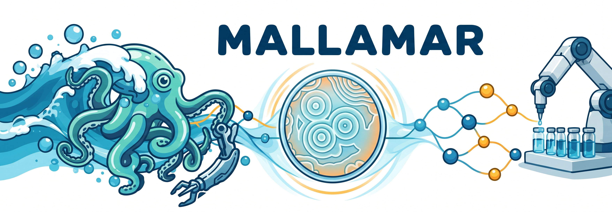

# Mallamar

Closed-loop BZ chemistry with Bayesian optimization, language-model proposals
and robotic experiments.

Mallamar connects **ALICE**, a campaign agent and your robot controller through
a shared mailbox. Each optimization batch contains six experiments. Results
update the candidate pool before the next batch is selected.

## The method

| Campaign mode | ALICE BO points | LLM-selected points | Local papers |
| --- | ---: | ---: | --- |
| `bo` | 6 | 0 | Optional |
| `bo-llm` — default | 3 | 3 | Required |
| `llm` | 0 | 6 | Required |

All modes use the bundled ALICE backend with **T5Gemma s-s-prefixlm,
qLogNParEGO and embedding fine-tuning**. The shared configuration is
[`t5gemma_s_joint.yaml`](agent_lg/configs/t5gemma_s_joint.yaml).

ALICE runs in every mode and shares its primary suggestions and reserves with
the BO specialist. Pure BO keeps all six primary points. The other modes combine
those candidates with hypothesis-driven LLM proposals, which are matched to
distinct, unmeasured rows of the candidate pool. Incomplete selections pause the
campaign rather than being filled with extra BO points.

For a pure BO campaign with no observations, the first batch uses six Sobol
points. Once measurements are available, ALICE fits the model and proposes BO
points. A chat model coordinates the campaign in all three modes, including `bo`.

## Install

Run from the repository root:

```bash
conda env create -f environment.yaml
conda activate mallamar
```

Alternatively, in a Python 3.11 environment:

```bash
pip install .
```

Both installation routes use [`requirements.txt`](requirements.txt). ALICE is
bundled in `vendor/alice`; a separate ALICE installation is unnecessary.
GPU execution needs a compatible NVIDIA driver and PyTorch installation.
For runs without internet access, cache the T5Gemma model before starting.

## Prepare a campaign

Use a dedicated workspace for the pool CSV, checkpoint and recovery records.
Provide these three inputs:

1. **Candidate pool:** a CSV containing the possible reaction conditions.
2. **Robot controller:** a listener implementing the shared mailbox protocol and
   writing experiment measurements.
3. **Reference papers:** a directory of PDF, TXT or MD files for `bo-llm` and `llm`.
   Online literature retrieval is optional supplementary evidence.

### Candidate CSV

The repository includes an [unmeasured 10,000-point BZ pool](datasets/mallamar_bz_pool_10k.csv)
with reaction prompts and empty experiment ID, raw metric and reward columns.
It contains no experimental measurements. Copy it into your campaign workspace
before starting; Mallamar updates that working copy as results arrive.

```bash
# Replace /path/to/mallamar with your repository location.
cp /path/to/mallamar/datasets/mallamar_bz_pool_10k.csv pool.csv
```

Each row represents one candidate. These columns are required:

| Column | Contents |
| --- | --- |
| `prompt` | Reaction description used by T5Gemma; consistent with that row's concentrations. |
| `conc_MA_M`, `conc_NaBrO3_M`, `conc_H2SO4_M`, `conc_Ru_M` | Reagent concentrations in mol/L. |
| `exp_id` | Unique experiment identifier for an attempted row; empty for an unattempted candidate. |
| `reward_oscillation`, `reward_signal` | Both reward values for measured rows; empty for unattempted candidates. |

Keep candidate row order, concentrations and prompt text fixed during a campaign.
Each new batch needs at least six distinct, unmeasured candidates. For live
reward calculation, the controller must also supply the raw metrics consumed by
[`rewards.py`](agent_lg/rewards.py).

### Robot connection

Create a `.env` file in the campaign workspace:

```dotenv
OCEAN_MAILBOX_ROOT=/absolute/path/to/controller
OCEAN_RESULTS_DB=/absolute/path/to/experiments_db.txt
```

The client exchanges commands and status in `mailbox/optimizer_to_hw.txt` and
`mailbox/hw_to_optimizer.txt` beneath `OCEAN_MAILBOX_ROOT`. The controller builds
and executes the physical robot steps, reports progress and writes results to
`OCEAN_RESULTS_DB`. See the [mailbox client](agent_lg/scripts/io_mailbox.py) and
[robot worker](agent_lg/scripts/robot.py) for the message format.
The existing `OCEAN_` setting names are retained for compatibility.

## Run

With your Ollama server running and `qwen2.5:14b` available, start a campaign from
its workspace:

```bash
mallamar --db pool.csv --papers references/papers \
  --campaign-mode bo-llm --reward-mode recompute \
  --backend openai --model qwen2.5:14b \
  --base-url http://localhost:11434/v1 --api-key ollama \
  --n_bo_iters 5 --thread-id campaign-1 --checkpoint-db checkpoints.sqlite
```

Here, `--backend openai` selects the OpenAI-compatible client used to connect to
Ollama. The chat model is separate from the fixed T5Gemma model used by ALICE.
For six BO points, use `--campaign-mode bo` and omit `--papers`. For six
LLM-selected points, use `--campaign-mode llm` and keep the local paper directory.

The default backend is Anthropic. To use it, set `ANTHROPIC_API_KEY` and omit the
Ollama backend, model, URL and API-key arguments.

Successful QC is required before submitting each new campaign batch; QC is
separate from the six optimization experiments. Restarts reuse completed QC.
Submission requests operator approval by default.
QC concentrations and durations are defined in [`config.py`](agent_lg/config.py).

Choose reward normalization explicitly for a live campaign:

| `--reward-mode` | Behavior |
| --- | --- |
| `recompute` | Refit normalization over observed measurements after each batch. |
| `freeze` | Fit normalization on the first batch and reuse it. Embedding training stays enabled. |
| `off` — default | Leave supplied rewards unchanged. |

Normalization uses successful measurements only and needs at least two successes.
If it cannot be fitted, the campaign pauses with its measurements preserved; it
never saves NaN constants. Provide sufficient initial measurements or a valid
`reward_norm.json` for `freeze` mode before restarting an underdetermined run.

## Replay a measured dataset without a robot

Use `--dry-run --replay-data` to run the same campaign graph against recorded BZ
measurements. No mailbox or hardware listener is needed. Sobol initialization
uses concentrations; subsequent BO uses the existing ALICE `MultiDeepGP`,
trainable T5Gemma embeddings and fixed qLogNParEGO. The reasoning model and T5Gemma
are still required.

```bash
mallamar --dry-run --replay-data /path/to/measured_grid.csv \
  --db runs/demo/pool.csv --checkpoint-db runs/demo/checkpoints.sqlite \
  --campaign-mode bo-llm --papers references/papers \
  --reward-mode recompute --n_bo_iters 4 --thread-id replay-demo \
  --backend openai --model qwen2.5:14b \
  --base-url http://localhost:11434/v1 --api-key ollama --auto-approve
```

The source CSV must contain one measurement per distinct composition, with the
four `conc_*` columns listed above and these robot-result columns:
`interp_period_mean_s`, `interp_period_std_s`, `interp_maxima_mean_V`,
`interp_maxima_std_V`, `interp_amplitude_mean_V`, `interp_amplitude_std_V`,
`total_time_s` and `n_osc`. Include failed experiments with `n_osc=0`;
undefined oscillation descriptors may be empty for those rows. If provided,
`failure_mode` is preserved when that experiment is revealed. The public 10k
candidate template has no measurements and cannot serve as a replay source.

The source remains unchanged. A new working pool is built using the shared BZ
concentration-to-text template, with all outcomes hidden initially. Only selected
measurements are revealed through normal result collection and reward scoring.
Replay supports `recompute` and `freeze`; stored source rewards are ignored.
Without an explicit reward mode, the CLI selects `recompute` for dataset replay.
QC is explicitly simulated and does not assess hardware or chemistry. Use `bo`
for six BO points or `llm` for six LLM points, as for hardware campaigns.

Start in a fresh workspace; existing pools are never overwritten. Resume with
`mallamar --resume --thread-id replay-demo --checkpoint-db runs/demo/checkpoints.sqlite`.
Keep the source unchanged: its identity is checked on restart. Actual LLM outputs
can vary with model revisions and generation settings. `--dry-run` without
`--replay-data` retains the limited result-waiting mock, rather than dataset replay.

## Inspect and resume

```bash
mallamar --status --thread-id campaign-1 --checkpoint-db checkpoints.sqlite
mallamar --resume --thread-id campaign-1 --checkpoint-db checkpoints.sqlite
```

Resume restores the saved campaign settings and progress. Keep the pool CSV,
checkpoint, `.mallamar/` records and controller evidence together. Restore any
reported pool, configuration, prompt or paper mismatch before resuming. An
uncertain hardware submission requires verified controller evidence before the
campaign can continue.

## Python API

```python
from agent_lg import run_agent, resume_agent

thread = run_agent(
    "Run five batches with QC before each.",
    db_path="pool.csv", papers_dir="references/papers",
    campaign_mode="bo-llm", n_bo_iters=5, reward_mode="recompute",
    backend="openai", model_name="qwen2.5:14b",
    base_url="http://localhost:11434/v1", api_key="ollama",
    checkpoint_db="checkpoints.sqlite",
)

resume_agent(thread, checkpoint_db="checkpoints.sqlite")
```

## Adapt Mallamar to another reaction

The supplied workflow is BZ-specific. Another reaction requires Python changes
as well as a new dataset; renaming a CSV or editing the YAML alone is not enough.
Reuse ALICE, the agent graph, checkpointing and recovery. For a first adaptation,
keep numeric candidate variables, two maximized objectives and six experiments
per batch. Categorical variables or a different objective count need additional
changes and validation.

1. **Define the candidate pool and units.** List the conditions users can vary,
   their allowed values and units. Create one row per distinct candidate, with a
   consistent `prompt`, empty `exp_id` and empty rewards for unattempted rows.
   Replace the BZ column names in both [`config.py`](agent_lg/config.py) and
   [`rewards.py`](agent_lg/rewards.py). Set matching tolerances and rounding
   precision to suit the instrument and design-space resolution.

2. **Update condition validation and suggestion formatting.** Replace reagent
   aliases and BZ concentration requirements in
   [`protocols.py`](agent_lg/services/protocols.py). Update the explicit reagent
   mappings in [`tools/bo.py`](agent_lg/tools/bo.py) and
   [`suggestions.py`](agent_lg/services/suggestions.py), including cold-start
   output and final-batch matching. Keep the existing condition-based Sobol and
   nearest-candidate algorithms; supply the new variables in a consistent order.
   Check result matching in [`results.py`](agent_lg/services/results.py).

3. **Define measurements, objectives and failures.** In
   [`rewards.py`](agent_lg/rewards.py), replace the raw metric columns, derived
   quantities, coefficients and BZ-specific failure rule (`n_osc == 0`). Specify
   which outcomes count as chemical failures and which are instrument failures.
   Choose normalization explicitly. Update target names in the existing
   [`t5gemma_s_joint.yaml`](agent_lg/configs/t5gemma_s_joint.yaml), keeping them
   consistent across `REWARD_COLS`, BO and result-collection tools,
   [`pool checks`](agent_lg/services/pools.py), [`status`](agent_lg/services/status.py)
   and [`analysis tools`](agent_lg/tools/analysis.py). Set `REF_POINT` in
   `config.py` to suit the new objective scales for reported hypervolume.
   Search `agent_lg/` for the old column names and `n_osc` to catch remaining
   BZ-specific readers. The T5Gemma model, embedding fine-tuning and qLogNParEGO
   implementation can remain unchanged.

4. **Describe the new chemistry to T5Gemma and the agents.** Replace
   `reaction_prompt()` in [`protocols.py`](agent_lg/services/protocols.py) and
   regenerate candidate descriptions before starting a campaign. Replace the BZ
   scientific context and examples in [`prompts/`](agent_lg/prompts), especially
   `bz_context.md`, and supply relevant local papers for LLM-assisted modes.
   Update the campaign task text in [`cli.py`](agent_lg/cli.py), BZ examples in
   [`agents.py`](agent_lg/agents.py), observation labels in
   [`hypothesis.py`](agent_lg/tools/hypothesis.py) and
   [`tool descriptions`](agent_lg/tools_registry.py). State the actual variables,
   units and objectives so agent proposals match the dataset.

5. **Adapt result collection for the execution mode.** Update the result-field
   mappings, summaries and failure records in [`tools/robot.py`](agent_lg/tools/robot.py).
   For offline replay, also replace the BZ raw-metric checks in
   [`ReplayController`](agent_lg/services/replay.py); it must reveal only selected
   measurements and use the same scoring as a live campaign. For hardware runs,
   update QC settings in [`config.py`](agent_lg/config.py), the experiment payload
   in [`io_mailbox.py`](agent_lg/scripts/io_mailbox.py) and the external hardware
   listener to execute the new reaction and return the agreed measurement schema.

6. **Validate with measured data before hardware.** Use the replay command above
   with a small measured dataset and enough candidates for at least two batches.
   Start with `bo`, then test `bo-llm` and `llm` in separate fresh workspaces with
   the new papers. Check known reward calculations, seeded Sobol conditions,
   variable units, candidate matching, successful and failed measurements, saved
   hypotheses, and crash/resume without selecting attempted rows again. Confirm
   unselected outcomes stay hidden. Validate the hardware listener and QC
   separately before starting physical experiments.

Start a new campaign after adapting the reaction. Existing campaigns verify
recorded configurations, prompts and candidate identities on resume; do not
reuse a BZ checkpoint with a changed reaction definition.

## Reproducibility and license

Numerical reproduction depends on the dependency versions, model revisions,
data, papers and GPU environment. The shared environment pins the main runtime
versions; it is not a complete historical environment lock.

Mallamar is licensed under [Apache-2.0](LICENSE). Bundled ALICE and upstream
attributions are retained in [NOTICE](NOTICE) and
[`vendor/alice/LICENSE-ALICE`](vendor/alice/LICENSE-ALICE).
