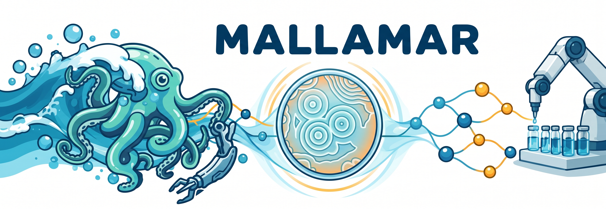

# Mallamar

Closed-loop BZ chemistry with Bayesian optimization, language-model proposals
and robotic experiments.

Mallamar connects **ALICE**, a campaign agent and your robot controller through
a shared mailbox. Each optimization batch contains six experiments. Results
update the candidate pool before the next batch is selected.

## The method

| Campaign mode | ALICE BO points | LLM-selected points | Local papers |
| --- | ---: | ---: | --- |
| `bo` | 6 | 0 | Optional |
| `bo-llm` — default | 3 | 3 | Required |
| `llm` | 0 | 6 | Required |

All modes use the bundled ALICE backend with **T5Gemma s-s-prefixlm,
qLogNParEGO and embedding fine-tuning**. The shared configuration is
[`t5gemma_s_joint.yaml`](agent_lg/configs/t5gemma_s_joint.yaml).

ALICE runs in every mode and shares its primary suggestions and reserves with
the BO specialist. Pure BO keeps all six primary points. The other modes combine
those candidates with hypothesis-driven LLM proposals, which are matched to
distinct, unmeasured rows of the candidate pool. Incomplete selections pause the
campaign rather than being filled with extra BO points.

For a pure BO campaign with no observations, the first batch uses six Sobol
points. Once measurements are available, ALICE fits the model and proposes BO
points. A chat model coordinates the campaign in all three modes, including `bo`.

## Install

Run from the repository root:

```bash
conda env create -f environment.yaml
conda activate mallamar
```

Alternatively, in a Python 3.11 environment:

```bash
pip install .
```

Both installation routes use [`requirements.txt`](requirements.txt). ALICE is
bundled in `vendor/alice`; a separate ALICE installation is unnecessary.
GPU execution needs a compatible NVIDIA driver and PyTorch installation.
For offline campaigns, cache the T5Gemma model before starting.

## Prepare a campaign

Use a dedicated workspace for the pool CSV, checkpoint and recovery records.
Provide these three inputs:

1. **Candidate pool:** a CSV containing the possible reaction conditions.
2. **Robot controller:** a listener implementing the shared mailbox protocol and
   writing experiment measurements.
3. **Reference papers:** a directory of PDF, TXT or MD files for `bo-llm` and `llm`.
   Online literature retrieval is optional supplementary evidence.

### Candidate CSV

The repository includes an [unmeasured 10,000-point BZ pool](datasets/mallamar_bz_pool_10k.csv)
with reaction prompts and empty experiment ID, raw metric and reward columns.
It contains no experimental measurements. Copy it into your campaign workspace
before starting; Mallamar updates that working copy as results arrive.

```bash
# Replace /path/to/mallamar with your repository location.
cp /path/to/mallamar/datasets/mallamar_bz_pool_10k.csv pool.csv
```

Each row represents one candidate. These columns are required:

| Column | Contents |
| --- | --- |
| `prompt` | Reaction description used by T5Gemma; consistent with that row's concentrations. |
| `conc_MA_M`, `conc_NaBrO3_M`, `conc_H2SO4_M`, `conc_Ru_M` | Reagent concentrations in mol/L. |
| `exp_id` | Unique experiment identifier for an attempted row; empty for an unattempted candidate. |
| `reward_oscillation`, `reward_signal` | Both reward values for measured rows; empty for unattempted candidates. |

Keep candidate row order, concentrations and prompt text fixed during a campaign.
Each new batch needs at least six distinct, unmeasured candidates. For live
reward calculation, the controller must also supply the raw metrics consumed by
[`rewards.py`](agent_lg/rewards.py).

### Robot connection

Create a `.env` file in the campaign workspace:

```dotenv
OCEAN_MAILBOX_ROOT=/absolute/path/to/controller
OCEAN_RESULTS_DB=/absolute/path/to/experiments_db.txt
```

The client exchanges commands and status in `mailbox/optimizer_to_hw.txt` and
`mailbox/hw_to_optimizer.txt` beneath `OCEAN_MAILBOX_ROOT`. The controller builds
and executes the physical robot steps, reports progress and writes results to
`OCEAN_RESULTS_DB`. See the [mailbox client](agent_lg/scripts/io_mailbox.py) and
[robot worker](agent_lg/scripts/robot.py) for the message format.
The existing `OCEAN_` setting names are retained for compatibility.

## Run

With your Ollama server running and `qwen2.5:14b` available, start a campaign from
its workspace:

```bash
mallamar --db pool.csv --papers references/papers \
  --campaign-mode bo-llm --reward-mode recompute \
  --backend openai --model qwen2.5:14b \
  --base-url http://localhost:11434/v1 --api-key ollama \
  --n_bo_iters 5 --thread-id campaign-1 --checkpoint-db checkpoints.sqlite
```

Here, `--backend openai` selects the OpenAI-compatible client used to connect to
Ollama. The chat model is separate from the fixed T5Gemma model used by ALICE.
For six BO points, use `--campaign-mode bo` and omit `--papers`. For six
LLM-selected points, use `--campaign-mode llm` and keep the local paper directory.

The default backend is Anthropic. To use it, set `ANTHROPIC_API_KEY` and omit the
Ollama backend, model, URL and API-key arguments.

The agent workflow requests QC before each batch; QC is separate from the six
optimization experiments. **QC is currently enforced by the agent instructions,
not a submission guard.** Submission requests operator approval by default.
QC concentrations and durations are defined in [`config.py`](agent_lg/config.py).

Choose reward normalization explicitly for a live campaign:

| `--reward-mode` | Behavior |
| --- | --- |
| `recompute` | Refit normalization over observed measurements after each batch. |
| `freeze` | Fit normalization on the first batch and reuse it. Embedding training stays enabled. |
| `off` — default | Leave supplied rewards unchanged. |

## Inspect and resume

```bash
mallamar --status --thread-id campaign-1 --checkpoint-db checkpoints.sqlite
mallamar --resume --thread-id campaign-1 --checkpoint-db checkpoints.sqlite
```

Resume restores the saved campaign settings and progress. Keep the pool CSV,
checkpoint, `.mallamar/` records and controller evidence together. Restore any
reported pool, configuration, prompt or paper mismatch before resuming. An
uncertain hardware submission requires verified controller evidence before the
campaign can continue.

## Python API

```python
from agent_lg import run_agent, resume_agent

thread = run_agent(
    "Run five batches with QC before each.",
    db_path="pool.csv", papers_dir="references/papers",
    campaign_mode="bo-llm", n_bo_iters=5, reward_mode="recompute",
    backend="openai", model_name="qwen2.5:14b",
    base_url="http://localhost:11434/v1", api_key="ollama",
    checkpoint_db="checkpoints.sqlite",
)

resume_agent(thread, checkpoint_db="checkpoints.sqlite")
```

## Reproducibility and license

Numerical reproduction depends on the dependency versions, model revisions,
data, papers and GPU environment. The shared environment pins the main runtime
versions; it is not a complete historical environment lock.

Mallamar is licensed under [Apache-2.0](LICENSE). Bundled ALICE and upstream
attributions are retained in [NOTICE](NOTICE) and
[`vendor/alice/LICENSE`](vendor/alice/LICENSE).
